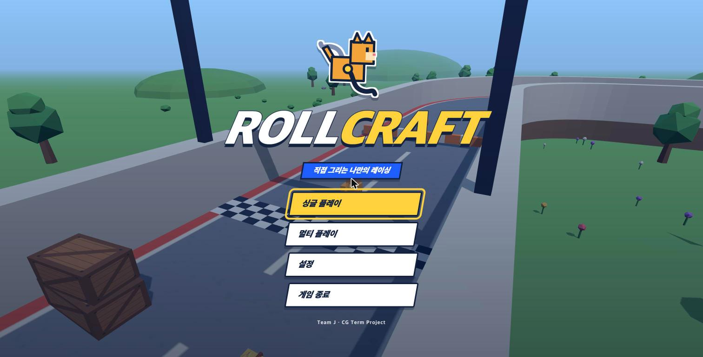
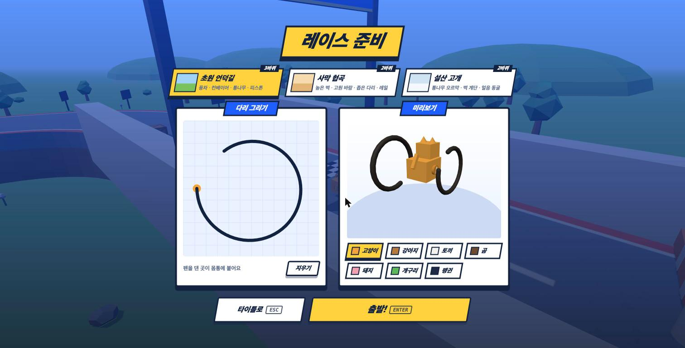
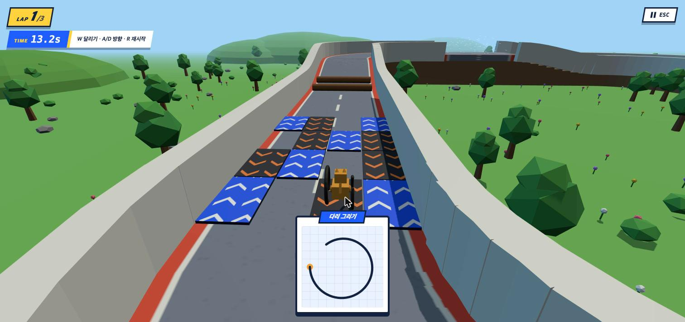
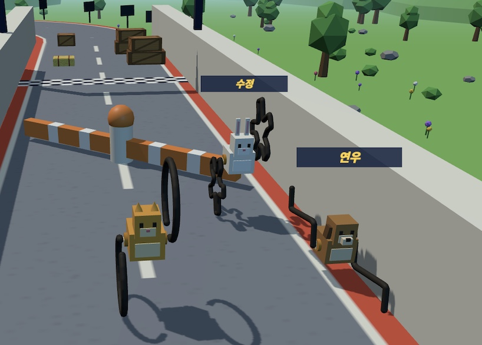

# RollCraft

**직접 그리는 나만의 레이싱.** 그리기 칸에 선을 하나 그으면 그 선이 캐릭터의 다리가 되어 돌면서 달립니다.
장애물마다 유리한 다리 모양이 달라서, 달리는 도중에도 상황에 맞게 다리를 다시 그리며 완주하는 3D 물리 레이싱 게임입니다.

컴퓨터그래픽스 텀프로젝트 · Team J (원유승 · 손연우 · 최수정)



- **바로 플레이:** <https://rollcraft-8cz4.onrender.com> (무료 서버라 첫 접속에 30초~1분 걸릴 수 있어요)
- **데모 영상:** <https://youtu.be/ghfl3HwHsQQ>
- **기술 문서:** [GitHub Wiki](https://github.com/yoosng/rollcraft/wiki)

## 게임 소개

| 다리 그리기                               | 레이스                               | 멀티 플레이                                 |
| ----------------------------------------- | ------------------------------------ | ------------------------------------------- |
|  |    |  |
| 그린 선이 바로 양쪽 다리가 됩니다         | 컨베이어 · 통나무 · 바람 같은 장애물 | 방 코드로 2~6명이 함께                      |

- **그린 대로 움직이는 다리:** 어떤 선이든 물리로 움직이는 다리가 됩니다. 달리는 중에 다시 그리면 그 자리에서 바뀌고, 그리는 동안은 시간이 0.2배로 느려집니다.
- **모양마다 다른 움직임:** 큰 다리는 벽을 잘 넘고, 작은 다리는 바람에 잘 버티고, 긴 다리는 통나무를 잘 넘습니다.
- **테마 맵 3개:** 초원 · 사막 · 설산. 언덕과 움직이는 장애물이 있고, 같은 장애물은 한 바퀴에 한 번만 나옵니다.
- **온라인 멀티 플레이:** 방 코드로 들어가 실시간 순위를 보며 같이 달립니다.
- **전부 코드로 생성:** 외부 3D 모델 · 이미지 · 음원 파일 없이 모양, 텍스처, 배경음, 효과음을 모두 코드로 만듭니다.

## 실행

Node.js **20.19 이상**이 필요합니다.

```bash
npm install
npm run dev        # 게임: http://localhost:5173/
npm run server     # 멀티 플레이 중계 서버 (로컬에서 멀티를 해 볼 때, 포트 8787)
```

| 명령             | 설명                                           |
| ---------------- | ---------------------------------------------- |
| `npm run dev`    | 개발 서버 (수정하면 바로 반영)                 |
| `npm run server` | 멀티 플레이 중계 서버                          |
| `npm run build`  | 배포용 빌드 → `dist/`                          |
| `npm start`      | 빌드된 게임 + 중계 서버를 주소 하나로 (배포용) |
| `npm run format` | Prettier로 코드 포맷 맞추기                    |

## 조작

**대기 화면**

| 입력                      | 동작                                                               |
| ------------------------- | ------------------------------------------------------------------ |
| 그리기 칸에 마우스 드래그 | 다리 그리기 (펜을 처음 댄 곳이 몸통에 붙음)                        |
| 맵 카드                   | 초원 · 사막 · 설산 고르기 (멀티에서는 방장만)                      |
| 동물 버튼                 | 고양이 · 강아지 · 토끼 · 곰 · 돼지 · 개구리 · 펭귄 (생김새만 다름) |
| `Enter`                   | 출발                                                               |

**레이스**

| 입력                | 동작                                               |
| ------------------- | -------------------------------------------------- |
| `W` / `S` (↑ / ↓)   | 다리를 돌려 앞으로 / 뒤로                          |
| `A` / `D` (← / →)   | 방향 바꾸기                                        |
| 화면 아래 그리기 칸 | 달리면서 다리 다시 그리기 (그리는 동안 시간 0.2배) |
| 화면 마우스 드래그  | 시점 둘러보기 (놓으면 뒤쪽 시점으로 돌아옴)        |
| `R`                 | 처음부터 다시 (싱글 플레이)                        |
| `Esc`               | 일시정지                                           |

## 맵

| 맵          | 길이 · 바퀴 | 장애물                                                                           |
| ----------- | ----------- | -------------------------------------------------------------------------------- |
| 초원 언덕길 | 208m × 3    | 풍차 막대 · 컨베이어 · 통나무 언덕 · 옆바람 · 피스톤 · 블록 길 · 급커브          |
| 사막 협곡   | 251m × 2    | 바위 길 · 높은 벽 · 오르막 · 고원 바람 · 좁은 다리 · 피스톤 · 분할 레일 · 구덩이 |
| 설산 고개   | 259m × 2    | 회전 막대 · 통나무 오르막 · 벽 계단 · 얼음 동굴 · 얼음덩이 길 · 옆바람           |

트랙에서 떨어지면 조금 뒤 바닥이 있는 곳에서 다시 출발합니다.

## 기술 스택

| 기술                                             | 역할                                                                      |
| ------------------------------------------------ | ------------------------------------------------------------------------- |
| [three.js](https://threejs.org/)                 | 렌더링 (WebGL). 기본 도형 조합, 캔버스 텍스처, 그림자, InstancedMesh 배경 |
| [cannon-es](https://github.com/pmndrs/cannon-es) | 물리 엔진 (교수님 사용 허가). 몸통과 다리를 경첩 모터로 연결              |
| Web Audio API                                    | 배경음 · 효과음 합성                                                      |
| WebSocket + Node.js                              | 멀티 플레이 중계 서버 (외부 패키지 없이 직접 구현)                        |
| [Vite](https://vite.dev/)                        | 개발 서버 · 빌드                                                          |

순수 JavaScript (ES modules), 프레임워크 없음.

## 구현 요약

- **그린 선 → 다리:** 그리기 칸 점을 미터 단위로 바꾸고(시작점 = 경첩, 최대 1.3m) 고르게 다시 찍은 뒤, 오른쪽은 그대로 · 왼쪽은 180° 돌려 붙입니다. 화면용은 `TubeGeometry`, 물리용은 선을 따라 놓은 얇은 상자입니다.
- **움직임:** 몸통은 항상 똑바로 서 있고, 경첩 모터가 다리를 돌려 땅을 밉니다. 모터 속도는 `min(6 rad/s, 4.5 m/s ÷ 다리 길이)`로, 긴 다리가 너무 튀지 않게 했습니다. 물리는 1/240초 고정 간격으로 계산합니다.
- **트랙:** 직선 · 곡선 조각 목록으로 트랙을 만듭니다. 곡선은 7.5°마다 상자 하나, 언덕은 smoothstep으로 높이를 바꿔 기울인 상자로 이어 붙입니다.
- **카메라:** `PerspectiveCamera`가 플레이어 뒤에서 트랙 방향으로 따라가며 `lookAt`합니다.
- **멀티 플레이:** 물리는 각자의 브라우저가 계산하고, 서버는 위치를 초당 15번 중계만 합니다. 다른 플레이어는 서로 통과하는 유령으로 보입니다.

자세한 내용은 [Wiki 기술 문서](https://github.com/yoosng/rollcraft/wiki)를 참고하세요.

## 폴더 구조

```
rollcraft/
├─ index.html              컨테이너 div만 둠 (#game, #ui)
├─ server/relay.mjs        멀티 플레이 중계 서버 (+ 배포 때 dist/ 제공)
├─ src/
│  ├─ main.js              화면 흐름 (타이틀 → 대기 → 카운트다운 → 레이스 → 결과), 게임 루프
│  ├─ shared/              공용 계약 (contracts.js, events.js)
│  ├─ physics/             물리 월드, 캐릭터 (climber.js), 동물 · 다리 모양 (climberLook.js)
│  │  └─ spike/            브라우저 없이 물리만 돌리는 검증 스크립트
│  ├─ stage/               트랙, 카메라, 바퀴 세기, 테마 · 배경
│  │  ├─ levels/           맵 데이터 (meadow · desert · snow)
│  │  └─ obstacles/        장애물 (파일 하나 = 장애물 하나)
│  ├─ render/              조명 · 그림자, 재질
│  ├─ ui/                  타이틀, 대기 화면, HUD, 결과 화면
│  ├─ audio/               배경음 · 효과음 합성
│  └─ net/                 멀티 플레이 클라이언트, 다른 플레이어 표시
├─ docs/images/            README 스크린샷
├─ progress/               사람별 진행 기록
├─ AGENTS.md, TeamRules.md 팀 규칙 · AI 작업 지침
└─ render.yaml             배포 설정 (Render)
```

## 개발 도구

`npm run dev` 후 아래 주소로 따로 띄울 수 있습니다.

| 주소                                  | 내용                                                   |
| ------------------------------------- | ------------------------------------------------------ |
| `/src/stage/dev.html?map=meadow`      | 맵 전체를 위에서 보기 (`map` = meadow · desert · snow) |
| `/src/stage/dev.html?map=snow&at=114` | 트랙 중심선 거리 `at`(m) 지점을 플레이어 시점으로 보기 |

브라우저 없이 물리만 돌리는 검증 스크립트:

```bash
node src/stage/spike/courseCheck.mjs           # 맵 고리가 닫히는지, 길이 겹치지 않는지
node src/physics/spike/sectionLab.mjs          # 장애물별 다리 모양 9종 통과 시간
node src/physics/spike/circuitRun.mjs meadow 1 # 다리 하나로 맵 한 바퀴
```

## 배포

[Render](https://render.com/) 무료 플랜(싱가포르)에 `render.yaml`로 배포합니다. `yoosng` 브랜치에 푸시하면 자동으로 다시 빌드 · 배포되고, 게임 화면과 중계 서버가 같은 주소를 씁니다.

## 담당

| 이름   | 담당                        | 대표 작업                                      |
| ------ | --------------------------- | ---------------------------------------------- |
| 원유승 | Planning, Physics & Systems | 기획, 캐릭터 물리, 멀티 플레이, 개발 환경 세팅 |
| 손연우 | Stage & Camera              | 트랙 시스템, 카메라, 장애물                    |
| 최수정 | Geometry & Rendering        | 회전체 형상, 조명 · 그림자, UI                 |

협업 규칙은 [TeamRules.md](TeamRules.md), 진행 기록은 [progress/](progress/)에 있습니다.
